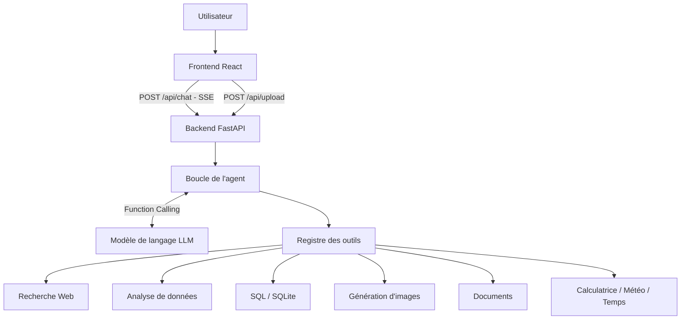

# ToolAgent — Agent conversationnel intelligent à outils


**Projet de Traitement Automatique du Langage Naturel (TALN)**  
**Sujet 10 : Agent conversationnel à outils**

ToolAgent est un assistant conversationnel intelligent conçu pour comprendre les demandes formulées en langage naturel, sélectionner dynamiquement les outils adaptés et exploiter leurs résultats afin de fournir des réponses pertinentes, structurées et contextualisées.

Contrairement à un chatbot classique, l'agent ne se limite pas à générer du texte. Il peut décider d'utiliser un ou plusieurs outils, exécuter les opérations nécessaires, interpréter les résultats et les restituer directement dans l'interface conversationnelle sous différentes formes : tableaux, graphiques, sources et images.

---

## Sommaire

- [1. Fonctionnalités](#1-fonctionnalités)
- [2. Architecture](#2-architecture)
- [3. Technologies utilisées](#3-technologies-utilisées)
- [4. Installation et lancement](#4-installation-et-lancement)
- [5. Scénarios de démonstration](#5-scénarios-de-démonstration)
- [6. Structure du projet](#6-structure-du-projet)
- [7. Extensibilité : ajouter un outil](#7-extensibilité--ajouter-un-outil)
- [8. Sécurité](#8-sécurité)
- [9. Tests et évaluation](#9-tests-et-évaluation)
- [10. Limites et perspectives](#10-limites-et-perspectives)
- [11. Dépannage](#11-dépannage)
- [12. Équipe et informations du projet](#12-équipe-et-informations-du-projet)

---

## 1. Fonctionnalités

ToolAgent combine les capacités d'un modèle de langage avec un ensemble d'outils spécialisés.

L'agent peut répondre directement aux questions générales ou faire appel aux outils lorsqu'une opération externe est nécessaire.

### Outils disponibles

| Catégorie | Outils | Fonctionnalités |
|---|---|---|
| Recherche Web | `web_search`, `fetch_url` | Recherche d'informations en ligne, lecture de pages et sources cliquables |
| Analyse de données | `analyze_dataset`, `make_chart`, `aggregate_dataset` | Lecture de CSV, Excel et JSON, statistiques, agrégations et graphiques |
| Base de données | `describe_database`, `run_sql` | Exploration du schéma SQL, interrogation de la base et résultats sous forme de tableaux |
| Génération d'images | `generate_image` | Création d'images à partir de descriptions textuelles |
| Documents | `summarize_document` | Lecture et résumé de documents PDF, DOCX, TXT et Markdown |
| Calculatrice | `calculator` | Exécution de calculs numériques |
| Météo et temps | `weather`, `get_datetime` | Consultation météorologique et récupération de la date et de l'heure |

### Fonctionnalités de l'interface

- Interface conversationnelle interactive.
- Streaming progressif des réponses.
- Affichage en temps réel des outils sélectionnés et de leur exécution.
- Visualisation des résultats sous forme de graphiques et de tableaux.
- Affichage de sources Web cliquables.
- Suggestions de questions complémentaires.
- Importation de fichiers par glisser-déposer.
- Historique local des conversations.
- Activation et désactivation individuelle des outils.
- Export des conversations et rapports au format Markdown.
- Thème clair et sombre.

### Orchestration multi-outils

L'agent peut enchaîner plusieurs opérations pour répondre à une même demande.

Par exemple, une question portant sur la météo d'une ville suivie d'une conversion de température peut nécessiter l'utilisation successive des outils météorologique et calculatrice.

---

## 2. Architecture

ToolAgent repose sur une architecture client-serveur composée d'un frontend React, d'un backend FastAPI et d'un agent central qui assure l'interaction entre le modèle de langage et les outils disponibles.

### Vue d'ensemble



### 2.1. Backend

Le backend est développé en Python avec FastAPI. Il assure la gestion des requêtes, l'orchestration de l'agent et l'exécution des outils.

Ses principales responsabilités sont :

- Gestion des conversations et des requêtes utilisateur.
- Communication avec le modèle de langage.
- Exécution des appels d'outils.
- Gestion des fichiers importés.
- Transmission progressive des réponses au frontend.
- Gestion des erreurs et des limites d'exécution.

### 2.2. Frontend

Le frontend est développé avec React 18 et Vite.

Il permet à l'utilisateur d'interagir avec l'agent, de suivre les opérations en cours et de consulter les résultats.

L'interface prend notamment en charge le rendu Markdown, les tableaux, les visualisations graphiques et les différents blocs de résultats.

### 2.3. Fonctionnement de la boucle d'agent

Le mécanisme central repose sur le Function Calling.

1. Le backend transmet au modèle le prompt système, l'historique de conversation et les descriptions des outils disponibles.
2. Le modèle analyse la demande et décide soit de répondre directement, soit de demander l'exécution d'un ou plusieurs outils.
3. Le backend identifie les outils demandés et exécute leurs fonctions respectives.
4. Les résultats sont transmis au modèle pour poursuivre le raisonnement ou préparer la réponse finale.
5. Les éléments visuels sont également transmis au frontend pour leur affichage.
6. Le processus continue jusqu'à la production d'une réponse finale ou l'atteinte de la limite d'exécution configurée.

La boucle prévoit également la gestion des erreurs afin de permettre au modèle de tenir compte des échecs rencontrés lors de l'exécution des outils.

### 2.4. Communication en temps réel : Server-Sent Events (SSE)

Le backend utilise le protocole SSE pour transmettre progressivement les événements au frontend.

| Événement | Rôle |
|---|---|
| `token` | Transmission d'un fragment de réponse |
| `tool_start` | Indication du démarrage d'un outil |
| `tool_result` | Transmission du résultat de l'exécution |
| `block` | Envoi d'un élément visuel : tableau, graphique, source ou image |
| `error` | Signalement d'une erreur |
| `done` | Fin du flux de communication |

Pour davantage de détails techniques, consulter [`docs/ARCHITECTURE.md`](docs/ARCHITECTURE.md).

---

## 3. Technologies utilisées

| Domaine | Technologies |
|---|---|
| Langage Backend | Python 3.10+ |
| Framework Backend | FastAPI, Uvicorn |
| Intelligence artificielle | LLM, Function Calling |
| Traitement des données | Pandas, OpenPyXL |
| Base de données | SQLite |
| Traitement documentaire | pypdf, python-docx |
| Recherche Web | DuckDuckGo, HTTPX, BeautifulSoup |
| Communication | API REST, Server-Sent Events |
| Frontend | React 18, JavaScript |
| Environnement Frontend | Vite |
| Visualisation | Recharts |
| Rendu Markdown | react-markdown, remark-gfm |
| Versionnement | Git, GitHub |

---

## 4. Installation et lancement

### 4.1. Prérequis

Avant de commencer, vérifier la présence des éléments suivants :

- Python 3.10 ou supérieur.
- Node.js 18 ou supérieur.
- npm.
- Une clé API valide pour le fournisseur de modèle choisi, sauf utilisation d'un modèle local.

Sur macOS, les outils peuvent être installés avec Homebrew :

```bash
brew install python node
```

### 4.2. Récupération du projet

Cloner le dépôt GitHub :

```bash
git clone https://github.com/malaksabirr/toolagent.git
cd toolagent
```

### 4.3. Configuration de l'environnement

Créer le fichier de configuration local à partir du modèle fourni :

```bash
cp .env.example .env
```

Ouvrir ensuite le fichier `.env` et renseigner les variables nécessaires.

Exemple de configuration avec Groq :

```env
LLM_BASE_URL=https://api.groq.com/openai/v1
LLM_API_KEY=votre_cle_api
LLM_MODEL=openai/gpt-oss-120b
```

### 4.4. Fournisseurs de modèles

Le backend utilise une interface de communication compatible avec l'API OpenAI.

Les fournisseurs suivants peuvent être envisagés selon la compatibilité de leur API et les adaptations disponibles :

| Fournisseur | URL de base | Exemple de modèle |
|---|---|---|
| Groq | `https://api.groq.com/openai/v1` | `openai/gpt-oss-120b` |
| OpenAI | `https://api.openai.com/v1` | `gpt-4o-mini` |
| Ollama | `http://localhost:11434/v1` | `qwen2.5:7b` |
| Anthropic | Via un adaptateur compatible | Selon le modèle configuré |

**Remarque :** le modèle sélectionné doit prendre en charge le Function Calling pour permettre à l'agent d'utiliser ses outils. La compatibilité effective dépend également du fournisseur et de son API.

### 4.5. Lancement de l'application

Après avoir configuré le fichier `.env`, exécuter :

```bash
./run.sh
```

Le script de lancement automatise la préparation de l'environnement et le démarrage des services selon sa configuration.

Les adresses d'accès sont :

| Service | Adresse |
|---|---|
| Interface Web | http://localhost:5173 |
| Backend API | http://localhost:8000 |
| Documentation API | http://localhost:8000/docs |

### 4.6. Lancement manuel

Il est également possible de démarrer les deux parties séparément.

**Terminal 1 — Backend**

```bash
python3 -m venv backend/.venv
source backend/.venv/bin/activate

pip install -r backend/requirements.txt

cd backend
uvicorn app.main:app --reload --port 8000
```

**Terminal 2 — Frontend**

```bash
cd frontend

npm install
npm run dev
```

L'interface est ensuite accessible sur http://localhost:5173.

---

## 5. Scénarios de démonstration

Les scénarios suivants permettent de découvrir les principales capacités de ToolAgent.

Les fichiers d'exemple sont disponibles dans le dossier `samples/`.

| # | Scénario | Exemple de demande | Outil(s) |
|---|---|---|---|
| 1 | Analyse de données | « Analyse ce fichier CSV et présente-moi les principaux résultats avec des graphiques. » | `analyze_dataset`, `make_chart` |
| 2 | Agrégation | « Quel est le total des ventes par région ? » | `aggregate_dataset` |
| 3 | Recherche Web | « Recherche les dernières actualités sur l'intelligence artificielle. » | `web_search` |
| 4 | Interrogation SQL | « Quels sont les cinq clients qui ont le plus dépensé ? » | `describe_database`, `run_sql` |
| 5 | Génération d'images | « Crée une image d'un paysage marocain au coucher du soleil. » | `generate_image` |
| 6 | Résumé documentaire | « Résume ce document et présente ses idées principales. » | `summarize_document` |
| 7 | Question générale | « Explique la différence entre un RNN et un Transformer. » | Aucun outil |
| 8 | Calcul numérique | « Combien font 17,5 % de 23 480 ? » | `calculator` |
| 9 | Multi-outils | « Quelle est la météo à Rabat et convertis 22 °C en Fahrenheit. » | `weather`, `calculator` |

Ces scénarios permettent d'observer la sélection des outils, leur exécution et la restitution des résultats dans l'interface.

---

## 6. Structure du projet

```text
toolagent/
│
├── backend/
│   ├── app/
│   │   ├── main.py              # API FastAPI et endpoints
│   │   ├── agent.py             # Boucle d'interaction LLM / outils
│   │   ├── prompts.py           # Instructions système de l'agent
│   │   └── tools/
│   │       ├── base.py          # Classes et registre communs
│   │       ├── web.py           # Recherche et lecture Web
│   │       ├── data.py          # Analyse de données
│   │       ├── sql.py           # Interrogation SQL
│   │       ├── image.py         # Génération d'images
│   │       ├── docs.py          # Traitement documentaire
│   │       └── utils.py         # Calcul, météo et temps
│   │
│   ├── tests/                   # Tests unitaires
│   ├── requirements.txt
│   └── seed_db.py               # Initialisation de la base de démonstration
│
├── frontend/
│   ├── src/
│   │   ├── App.jsx
│   │   ├── store.js
│   │   ├── api.js
│   │   ├── components/          # Composants de l'interface
│   │   └── views/               # Vues de l'application
│   ├── package.json
│   └── vite.config.js
│
├── docs/
│   └── ARCHITECTURE.md          # Documentation technique
│
├── samples/                     # Fichiers de démonstration
├── scripts/                     # Scripts utilitaires
├── .env.example                 # Modèle de configuration
├── .gitignore
├── Makefile
├── run.sh
└── README.md
```

---

## 7. Extensibilité : ajouter un outil

L'architecture de ToolAgent repose sur un registre commun permettant d'intégrer de nouveaux outils sans modifier le fonctionnement général de l'agent.

L'ajout d'une nouvelle fonctionnalité suit trois étapes :

**Étape 1 — Créer le module**

Créer un fichier dans `backend/app/tools/` :

```text
backend/app/tools/mon_outil.py
```

**Étape 2 — Implémenter la fonctionnalité**

Développer la fonction de traitement et retourner un objet `ToolResult` contenant le résultat ainsi que, si nécessaire, les éléments visuels associés.

**Étape 3 — Enregistrer l'outil**

Déclarer l'outil avec le mécanisme d'enregistrement du registre commun :

```python
registry.register(
    Tool(...)
)
```

Enfin, importer le module dans `tools/__init__.py`.

L'outil devient alors disponible pour le mécanisme de sélection de l'agent, selon les règles d'enregistrement et d'exposition définies dans le projet.

---

## 8. Sécurité

La sécurité est prise en compte dans la gestion des clés API, l'exécution des opérations et le traitement des fichiers.

Les mécanismes suivants sont prévus dans la conception et doivent être maintenus lors de toute évolution du projet :

| Domaine | Mesures de protection |
|---|---|
| Secrets | Stockage des clés API dans `.env`, exclu du versionnement Git |
| SQL | Limitation des requêtes aux opérations de lecture autorisées |
| Calculatrice | Évaluation contrôlée des expressions mathématiques |
| Lecture Web | Validation des URL et limitation des ressources récupérées |
| Fichiers | Contrôle des fichiers importés et de leur taille |
| Injection de prompt | Traitement des contenus externes comme des données non fiables |

**Bonne pratique :** chaque collaborateur doit créer son propre fichier `.env` à partir de `.env.example`. Les clés API, les fichiers personnels, les environnements virtuels et les bases de données locales ne doivent pas être publiés sur GitHub.

---

## 9. Tests et évaluation

### 9.1. Tests unitaires

Les tests des outils sont regroupés dans `backend/tests/`.

Pour les exécuter :

```bash
make test
```

Ou directement :

```bash
cd backend
pytest -q
```

### 9.2. Évaluation de l'agent

L'évaluation peut être réalisée à l'aide d'un notebook dédié, regroupant plusieurs scénarios de test couvrant les différentes catégories de demandes.

Les principaux critères d'évaluation sont :

- La précision de sélection des outils.
- La pertinence des réponses produites.
- La capacité à gérer plusieurs outils successifs.
- Le temps de réponse et la latence d'exécution.
- La gestion des erreurs.

Les résultats quantitatifs seront renseignés après l'exécution effective des évaluations.

---

## 10. Limites et perspectives

### Limites

- La qualité des décisions dépend des capacités du modèle de langage sélectionné.
- La recherche Web peut être affectée par les limitations des services externes.
- La disponibilité de certains outils dépend de leurs fournisseurs respectifs.
- L'historique local ne permet pas nécessairement une synchronisation entre plusieurs appareils.
- Les réponses générées sans recours à un outil peuvent comporter des informations inexactes.

### Perspectives d'amélioration

Plusieurs évolutions peuvent être envisagées :

- Mise en place d'une mémoire conversationnelle à long terme.
- Intégration d'un système RAG pour exploiter des bases documentaires.
- Amélioration de la vérification et de la traçabilité des sources.
- Comparaison de plusieurs modèles de langage.
- Élargissement du jeu de tests et automatisation de l'évaluation.
- Renforcement des mécanismes de sécurité et de validation des appels d'outils.

---

## 11. Dépannage

| Problème | Cause possible | Solution |
|---|---|---|
| Backend hors ligne | Serveur FastAPI arrêté | Vérifier le port 8000 et relancer le backend |
| Port déjà utilisé | Un autre processus utilise le port | Identifier le processus avec `lsof -i :8000` |
| Clé API invalide | Configuration incorrecte | Vérifier les variables dans `.env` |
| Modèle indisponible | Identifiant de modèle incorrect | Vérifier les modèles accessibles chez le fournisseur |
| Function Calling indisponible | Modèle incompatible | Sélectionner un modèle prenant en charge les appels d'outils |
| Recherche Web sans résultat | Limitation du service externe | Réessayer ultérieurement |
| Génération d'image échouée | Fournisseur temporairement indisponible | Vérifier sa configuration et réessayer |

---

## 12. Équipe et informations du projet

**Projet :** ToolAgent — Agent conversationnel intelligent à outils  
**Module :** Traitement Automatique du Langage Naturel (TALN)  
**Sujet :** Agent conversationnel à outils  
**Établissement :** EMSI Rabat  
**Année universitaire :** 2026–2027

**Dépôt GitHub :** [github.com/malaksabirr/toolagent](https://github.com/malaksabirr/toolagent)

---

*ToolAgent — Transformer les demandes en langage naturel en actions concrètes grâce à l'intelligence artificielle et à l'utilisation d'outils.*
