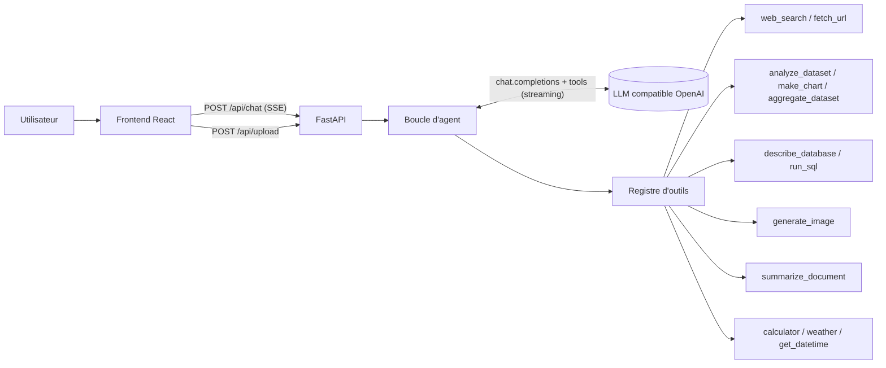

# Architecture — ToolAgent

## 1. Vue d'ensemble

## 2. Boucle d'agent (pattern ReAct par function calling)
1. Le prompt système (règles d'usage des outils, format de réponse, liste des fichiers) + l'historique sont envoyés au LLM avec les schémas JSON des outils.
2. Le LLM répond soit par du texte (réponse finale, streamée), soit par un ou plusieurs `tool_calls`.
3. Chaque outil est exécuté (thread séparé) ; son résultat texte retourne au LLM, ses **blocs UI** (graphiques, tableaux, sources, images) partent directement vers l'interface.
4. On boucle jusqu'à une réponse sans appel d'outil, ou `AGENT_MAX_STEPS` (8). Les erreurs d'outils sont renvoyées au modèle pour qu'il s'auto-corrige (ex. requête SQL fausse).

## 3. Protocole d'évènements SSE
| type | contenu | effet côté UI |
|---|---|---|
| `token` | `text` | ajout au texte (markdown) |
| `tool_start` | `id, name, label, args` | ligne « outil en cours » |
| `tool_result` | `id, ok, summary, ms` | coche + durée |
| `block` | `chart / table / sources / image / dataset / doc` | rendu riche |
| `error` | `message` | encart d'erreur lisible |
| `done` | — | fin du flux |

## 4. Choix de conception
- **Outils définis une fois** (`Tool` : schéma, description LLM, libellé UI, fonction) → le frontend se génère depuis `/api/tools`.
- **Séparation texte LLM / blocs UI** : le LLM reçoit des statistiques compactes, l'utilisateur voit de vrais graphiques ; pas de tokens gaspillés sur les données brutes.
- **Fournisseur LLM interchangeable** (API compatible OpenAI) : Groq, OpenAI, Anthropic, Ollama.
- **Structure de réponse imposée par le prompt** : réponse directe → détails (titres, listes, tableaux) → conclusion → 2–3 suggestions cliquables.
- **Répond à tout** : sans outil pertinent, l'agent répond directement avec ses connaissances ; les outils servent à vérifier, calculer, chercher ou produire.

## 5. Sécurité
- SQL : connexion SQLite `mode=ro`, une seule instruction `SELECT/WITH`, mots-clés d'écriture refusés, 200 lignes max.
- Calculatrice : évaluation via l'AST (aucun `eval`), fonctions mathématiques en liste blanche.
- `fetch_url` : refuse localhost / IP privées (anti-SSRF), taille de texte limitée.
- Uploads : identifiants aléatoires, noms nettoyés, 25 Mo max. Contenu web = donnée non fiable (risque d'injection de prompt).

## 6. Plan d'évaluation (pour le rapport)
Construire 30 questions réparties en 6 catégories (culture générale, actualité, données CSV, SQL, image, document) et mesurer :
1. **Précision du choix d'outil** (outil attendu vs appelé) ; 2. **exactitude des réponses** chiffrées (vérité terrain pandas/SQL) ;
3. **taux d'auto-correction** après erreur d'outil ; 4. **latence** (premier token, réponse complète) ; 5. comparaison de 2–3 modèles.
Limites connues : dépendance à la qualité du modèle pour le function calling, recherche web gratuite non garantie, historique non partagé entre navigateurs.
